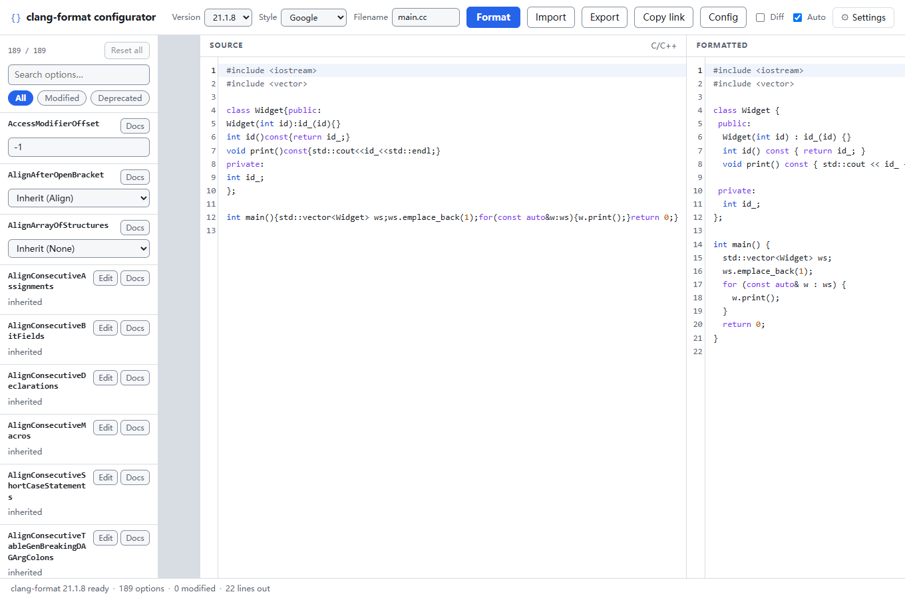

# clang-format configurator v3

[](https://github.com/lzh0394/clang-format-configurator-v3/actions/workflows/ci.yml)
[](https://github.com/lzh0394/clang-format-configurator-v3/actions/workflows/deploy.yml)
[](https://github.com/lzh0394/clang-format-configurator-v3/actions/workflows/nightly.yml)
[](https://github.com/deepseek-ai/deepseek-harness)

纯静态的 clang-format 配置器：选版本、选风格、在选项面板里改选项，浏览器内 wasm 实时格式化，导入/导出 `.clang-format`。没有后端，可以离线跑。

**在线**：<https://lzh0394.github.io/clang-format-configurator-v3/>



当前进度：**M0–M4 全部完成**（骨架/资源流水线、选项引擎、编辑器与 diff、持久化/主题/离线、分享链接、PWA、界面字号、全部 52 个版本、a11y 收尾、nightly 漂移检查）。开发状态、命令与踩过的坑见 [docs/handoff.md](docs/handoff.md)；设计与取舍的唯一事实来源是 [plan.md](plan.md)。

## 快速开始

```bash
npm install
npm run prepare:assets   # 下载 wasm、生成 schema（首次需要网络）
npm run dev              # http://localhost:5173
```

`public/schema/` 已提交进仓库；`public/wasm/` 不提交，由 `prepare:assets` 按 `tools/wasm.lock.json` 复现。

## 已实现（M0 + M1 + M2 + M3 + M4）

- **全部 52 个已发布版本**（16.0.6 – 23.1.1，默认 21.1.8）× **7 种风格**，版本列表由生成的 `schema/index.json` 驱动，加版本不用改代码；16/17/18.1.0–18.1.7/22/23 的 schema 默认值来自同版本 native clang-format 的 dump（运行期格式化仍用 wasm）。
- **选项面板**：每个版本 147–209 个选项的虚拟列表（动态行高）、搜索（键名 + 文档全文，120 ms 防抖）、过滤 chips（全部 / 已修改 / 已废弃）、逐项显示「继承值 vs 修改值」与单行 reset；单一 Tab 停靠点 + ↑/↓/Home/End/PageUp/PageDown 的 roving 键盘模型（跨虚拟窗口可达）。
- **五种控件**：bool / int / uint / string 标量、enum 下拉、map（结构体，稀疏修改）、`List of Strings`、`List of Structs`（增删条目、逐字段编辑）。
- **只发送改动项**：内部状态是 `{version, style, modified}`，格式化 payload 是 `{BasedOnStyle, ...modified}`；默认值只用于显示，不会再像 v2 那样把 190 个默认值全量物化。
- **CodeMirror 6 编辑器**：左栏可编辑源码、右栏只读格式化结果；语言随文件名（C/C++、Java、C#、Proto、Kotlin、Objective-C、JS/TS，`.clang-format` 为 YAML），Ctrl/Cmd+Enter 立即格式化，250 ms 防抖，编辑器字号 12–20 px 可调；文件名切到 C#/Proto/Java/Kotlin/JS/TS 时，若编辑器仍是未编辑的内置样例，会自动换成对应语言的示例。
- **分享链接**：`#s=<base64url(JSON)>` 编码 `{version, style, modified, code?}`，Copy link 一键复制；打开链接时 hash 优先于 localStorage，应用后自动清掉 fragment（之后编辑照常持久化）；code 超过 8 KB 时只分享配置，坏链接静默回退到本地存档。
- **可安装 PWA**：`manifest.json` + 192/512/maskable/apple-touch 图标；可安装时显示安装横幅（可关闭，安装后隐藏），SW 预缓存 manifest 与图标，断网也能用。
- **真实行级 diff**：`@codemirror/merge` 的 split 视图（不是 v2 的"左右并排"），变更行/片段高亮、两侧滚动同步、未变更区可折叠；按需加载，不进首屏。
- **Worker 协议**：请求串行化 + latest-wins（过期请求静默丢弃）、格式化期间捕获 LLVM 诊断、20 s 超时与 fatal 分类；worker 崩溃后自动重建并提示，状态不丢。
- **结构化错误面板**：一行摘要 + 可展开的 LLVM 诊断原文；如把 `ColumnLimit` 写成 schema 合法但 clang-format 不接受的值，就能看到原始报错。
- **配置页抽屉**：CM6 YAML 编辑器 + 基于 schema 的 150 ms 实时校验（语法错误带行列号、未知键/非法值降级为 warning）、Minimal/Full 模式、上传/下载 `.clang-format`、Apply/Close，以及相对当前配置的增删改键预览。
- **导出/导入**：Minimal（默认，只含 `BasedOnStyle` + 改动项）/ Full（全部写死，供锁版本）；导入按当前版本 schema 校验，未知键与非法值收集为 warning（不硬失败），legacy `AlignConsecutive*` / `SortIncludes` / `AlignTrailingComments` 自动转换成嵌套形式；YAML 语法错误带行列号。**导出 → 再导入 → 再导出字节幂等**（minimal 与 full 都有单测与 e2e）。
- **依赖项 override 警告**：`BraceWrapping` 只在 `BreakBeforeBraces: Custom` 时生效、`SpaceBeforeParensOptions` 只在 `SpaceBeforeParens: Custom` 时生效——改错父项时行内提示，并可一键把父项切成 `Custom`。
- **文档懒加载**：`docs.json` 首次搜索或首次展开某选项帮助时才拉取（~19–25 KB gzip），用构建期生成好的 HTML 渲染；渲染层给 `<pre>` 补 `tabindex=0` 并清理泄漏的 RST directive。
- **wasm 在 Worker 里跑**：主线程不阻塞，一个版本一个实例，换版本 terminate 旧 worker。
- **大输入保护**：>2 MB 源码先提示并需确认才格式化。
- **会话持久化**：`{version, style, modified, code, theme, editorFontSize, uiFontScale}` 存在 localStorage（带状态版本号），刷新/重开自动恢复；不兼容或损坏的存档会被丢弃并提示，存储不可用/写满只告警不阻塞。
- **字号**：编辑器字号 12–20 px 与界面字号 90%/100%/115% 各自独立、都持久化；界面字号通过根字号 + rem 缩放全站 UI（虚拟列表会重新测量行高），编辑器字号不跟着变。
- **主题与响应式**：跟随系统 / 浅色 / 深色三档（`data-theme` + 无闪白预置脚本），选择持久化；<768 px 时双栏变为「Options / Code」选项卡，键盘左右方向键可切换。
- **离线可用**：手写 Service Worker（`public/sw.js`，子路径安全）缓存 app shell 与已用版本 wasm/schema，断网后刷新仍能格式化；命中新版本时提示重载。
- **可访问性**：跳过导航链接、控件都有可访问名称、chips `aria-pressed`、文档展开 `aria-expanded`、对话框 `aria-labelledby`、错误 `role="alert"`、格式化结果 polite live region、`prefers-reduced-motion` 生效、控件边框对比度按 WCAG 1.4.11 处理；ConfigDialog/ConfigDrawer 共用焦点陷阱（Tab 循环、Escape、焦点归还），两个 modal 同开时只有顶层响应。
- **质量闸门**：`npm run check:size` 按 plan §1 检查首屏 JS/wasm/schema gzip 预算；`tests/golden/golden-21.1.8.json` 29 组由 **native clang-format 21.1.8** 生成，e2e 用 wasm 逐字节对拍（CI 再跑 `golden:gen --check` 防漂移），另有一条 p95 ≤ 80 ms 的格式化性能用例。
- **首屏 JS 224.5 KB gzip**（`check:size` 口径，预算 250 KB；上屏实际还要加 ~8 KB 的语言 chunk），单版本 wasm 902–1072 KB gzip。

## 脚本

| 命令 | 作用 |
|---|---|
| `npm run dev` | Vite 开发服务器 |
| `npm run build` | 生产构建到 `dist/` |
| `npm run preview` | 预览构建产物 |
| `npm run prepare:assets` | fetch-wasm + gen-schema |
| `npm run prepare:wasm` | 只下载 wasm（CI 用，schema 已入库） |
| `npm run schema:check` | 把 schema 重新生成到 `.cache/schema-check` 并与已提交内容逐文件比对（`-- --allow-missing-native` 供 nightly 用） |
| `npm run typecheck` | `tsc --noEmit` |
| `npm test` | Vitest 单测 |
| `npm run test:e2e` | Playwright（本地用 Edge：`channel=msedge`；CI 里 `PW_CHANNEL=chromium`） |
| `npm run verify` | typecheck + test + build |
| `npm run check:size` | 按 plan §1 检查构建产物的 gzip 预算（需先 `npm run build`） |
| `npm run golden:gen` | 用 native clang-format 21.1.8 重新生成黄金标准输出（`-- --check` 只校验） |

GitHub Pages 子路径构建：

```bash
VITE_BASE=/<repo>/ npm run build
```

## 目录

```
tools/
  versions.json          版本清单（唯一事实来源，52 行；native dump 的版本带 "dump": "native"）
  fetch-wasm.mjs         从 npm 拉 wasm，校验 sha512，生成统一 entry.js
  gen-schema.mjs         dump_config / native dump + LLVM RST → public/schema/<ver>/（--check 供 nightly）
  gen-golden.mjs         用 native 21.1.8 生成/校验 tests/golden 的期望输出
  check-size.mjs         按 plan §1 检查 dist 的 gzip 预算（52 个版本，CI 闸门）
  lib/rst.mjs            RST 解析 + 子集渲染成 HTML
src/
  App.tsx                版本/风格/文件名 + 选项面板 + 编辑器/diff + 持久化/分享链接/PWA/字号 + 状态栏
  editor/                CodeEditor（受控 CM6）、语言懒加载、示例代码、共享主题与字号变量
  components/            OptionPanel / OptionRow / controls（五种控件）/ ConfigDialog（快速导入导出）
                         ConfigDrawer（配置页抽屉）/ DiffPane（真实 split diff）/ ErrorPanel /
                         SettingsMenu（主题与字号）/ useDocs / roving（键盘模型）/ focus-trap（焦点陷阱）
  pwa/                   install.ts（beforeinstallprompt 生命周期）+ InstallBanner
  lib/
    schema.ts            schema 类型、资源加载、buildStylePayload
    schema-store.ts      版本 schema 与 docs 的 LRU 缓存（3 版本，失败不缓存）
    config.ts            modified 模型：继承值、稀疏 map、set/reset
    config-state.ts      ConfigState + useReducer reducer + 版本切换归一
    config-io.ts         .clang-format YAML 导出/导入（纯逻辑）
    config-diff.ts       配置抽屉的增删改键预览（纯逻辑）
    share-link.ts        URL hash 分享链接的编码/解码（纯逻辑）
    diagnostics.ts       LLVM 诊断拆分/去重（纯逻辑）
    formatter-client.ts  worker 封装：串行化、latest-wins、超时、fatal 重建
    persisted-state.ts   localStorage 会话持久化（带状态版本号，失败降级）
    theme.ts             system/light/dark 偏好解析与 data-theme 应用
    service-worker.ts    SW 注册、更新提示、在线/离线事件（prod-only）
  worker/                formatter.worker.ts（唯一 wasm 实例、console 诊断捕获）+ 协议
tests/
  golden/                29 组 native clang-format 21.1.8 黄金输出（提交入库）
  e2e/                   smoke（M0）+ m1 + m2 + m3 + m4（分享/字号/版本/语言）
                         + m4-pwa + m4-a11y + golden（wasm vs native）+ perf（p95）
public/
  schema/<ver>/          core.json（选项 + 默认值）、docs.json（文档），已提交（52 个版本）
  schema/index.json      版本下拉的数据源
  manifest.json          PWA manifest（相对 start_url/scope，子路径安全）
  icons/                 PWA 图标（192/512/maskable/apple-touch）
  sw.js                  手写的离线 Service Worker（Vite 原样拷进 dist）
  wasm/<ver>/            不提交，由 prepare:assets 生成
```

## 支持的版本

| 版本 | 状态 |
|---|---|
| 21.1.8（默认） | ✅ |
| 16.0.6 – 23.1.1 全部 52 个已发布 wasm 版本 | ✅ 默认值见下 |

- 18.1.8 – 21.1.8：wasm 自带 `dump_config`，schema 由它生成。
- 16.0.6、17.0.x、18.1.0–18.1.7、22.x、23.x：wasm 没有可用的 `dump_config`，schema 默认值由**同版本 native clang-format** dump 生成后提交（22.1.6/22.1.7 不在 PyPI，用 LLVM release 二进制）；运行期格式化仍用 wasm。26 个这样的版本做了 312/312 次 native vs wasm 逐字节对拍。
- 已知上游小问题：19.1.1 的 npm 包 `version()` 报 19.1.0（标签错），格式化行为与 native 19.1.1 一致，`core.build` 保留上游值，UI 状态栏显示选中版本号。

详见 [plan.md 第 3.1 节](plan.md)。

## 部署

推到 `main` 即自动发布到 GitHub Pages（`Settings → Pages → Source: GitHub Actions`）。工作流分三段：build（含 e2e）→ deploy → smoke（对线上 URL 再跑一遍 Playwright，等 Pages 返回 200 后开始）。子路径与缓存策略见 plan.md 第 8.1 节。`nightly.yml` 每天重新生成 schema 并与已提交内容比对，漂移只开 issue、不阻塞发布。

## 致谢

- [clang-format-configurator v2](https://github.com/Wirena/clang-format-configurator-v2)（MIT）：v3 的功能范围与交互设计参考了 v2 的实现与线上行为。
- [DeepSeek Harness](https://github.com/deepseek-ai/deepseek-harness)：本项目的开发与文档工作借助 dsh 完成。
- [LLVM](https://llvm.org/)：clang-format 本体及选项文档。
- [@wasm-fmt/clang-format](https://github.com/wasm-fmt/clang-format)：浏览器内运行的 clang-format wasm 构建。
- [React](https://react.dev/)、[Vite](https://vite.dev/)、[Playwright](https://playwright.dev/)、[Vitest](https://vitest.dev/)、[TanStack Virtual](https://tanstack.com/virtual)：界面、构建与测试依赖。

## 授权

代码 MIT，第三方材料与文档来源见 [NOTICE](NOTICE)。docstring 来自 LLVM 文档（Apache-2.0 WITH LLVM-exception），wasm 构建来自 [`@wasm-fmt/clang-format`](https://github.com/wasm-fmt/clang-format)（MIT）。
